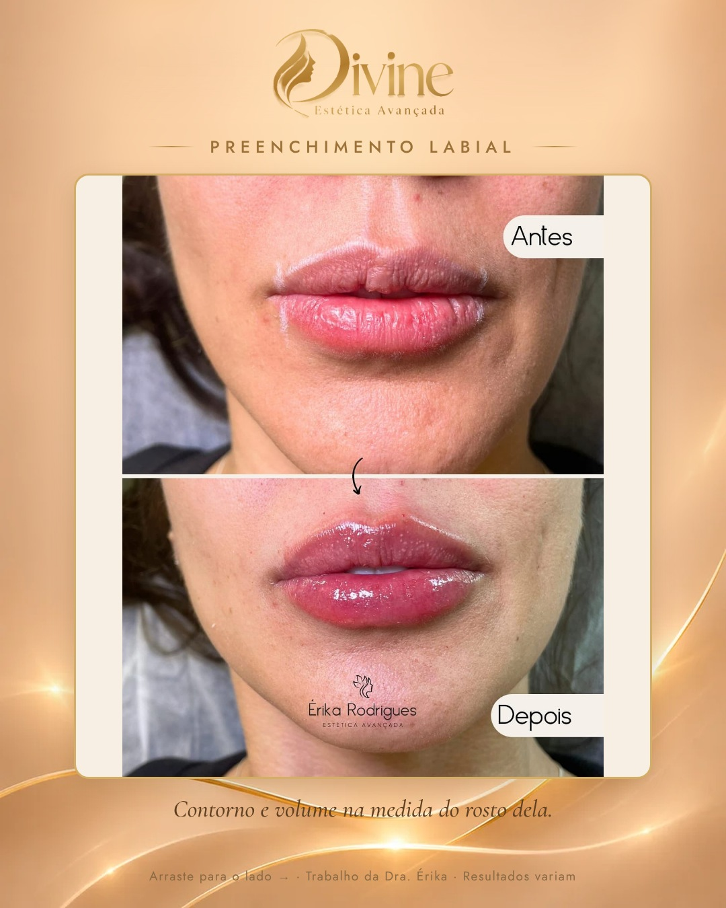
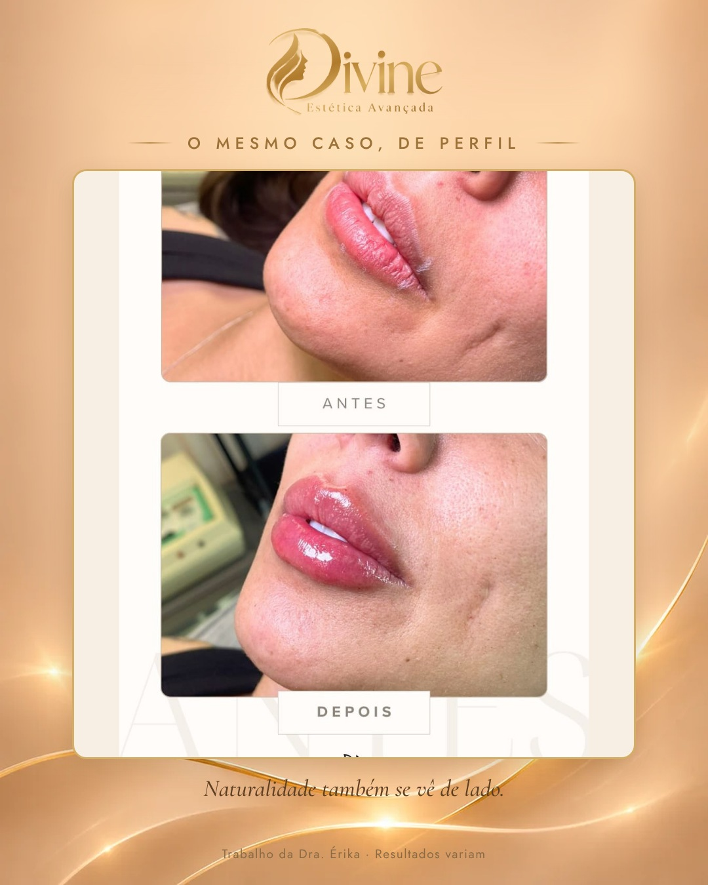
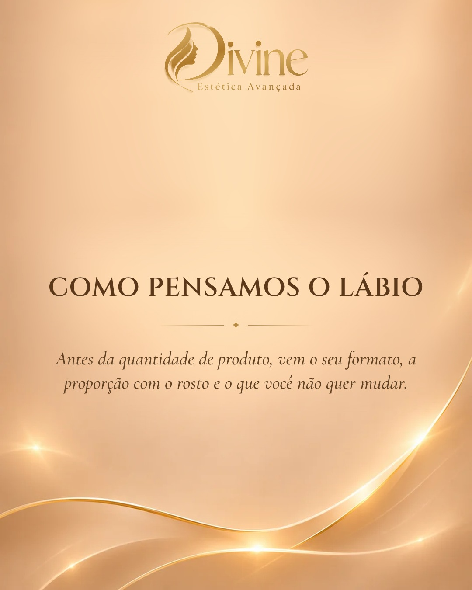

# 13/11 (sex)

[← Voltar ao cronograma](../README.md)

## Feed (carrossel 4) · 19h · P1 · Lábios naturais

**Como postar:** Não impulsionar. Story do dia: repost deste post ("Adicionar post ao story") com link do grupo.

   

**Legenda (copiar e colar):**

```
Lábio bonito é o que combina com o seu rosto. 💋

Nesse caso, a proposta foi definir o contorno e devolver volume com equilíbrio, respeitando o formato natural dela, de frente e de perfil.

Antes de pensar em quantidade de produto, a Dra. Érika avalia proporção, simetria e o que você não quer mudar.

Quer entender o que faz sentido para você? Fale com a gente pelo WhatsApp: link na bio.

#preenchimentolabial #labiosnaturais #esteticabrasilia #sudoestebrasilia #biomedicinaestetica

Trabalho da Dra. Érika, publicado com autorização da paciente. Resultados variam de pessoa para pessoa.

Dra. Érika Laura Rodrigues · Biomédica esteta · CRBM-3 19227
CLSW 101, Bloco B, Sala 82 · Multiplus Shopping · Sudoeste
```

**Aprovação:** [ ] aprovado  [ ] ajustar
