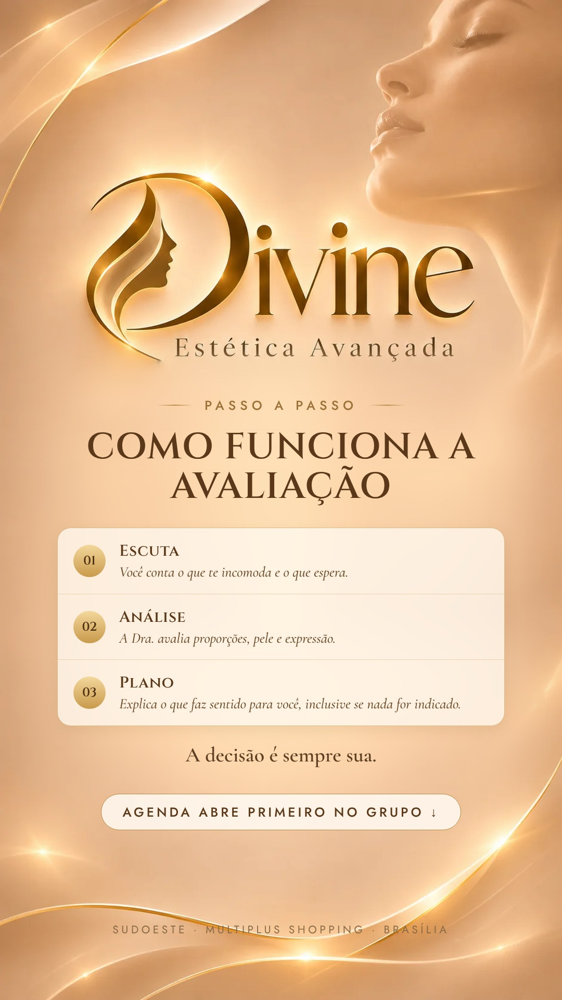

# 16/11 (seg)

[← Voltar ao cronograma](../README.md)

## Story · 12h · Como funciona a avaliação

**Como postar:** Figurinha de link do Grupo VIP



**Aprovação:** [ ] aprovado  [ ] ajustar

## Feed (carrossel 5) · 19h · Como funciona a avaliação

**Como postar:** Link na bio. Repost no story às 20h30.

    

**Legenda (copiar e colar):**

```
Como funciona a avaliação na Divine? 🤍

1. Escuta: você conta o que te incomoda, o que espera e o que não quer mudar.
2. Análise: a Dra. Érika avalia proporções, pele e expressão, olhando o seu rosto como um todo.
3. Plano: ela explica o que faz sentido para você, inclusive quando a indicação é não fazer nada.

A decisão é sempre sua.

A agenda de avaliações abre primeiro para quem está no Grupo VIP. O link está na bio.

Dra. Érika Laura Rodrigues · Biomédica esteta · CRBM-3 19227
CLSW 101, Bloco B, Sala 82 · Multiplus Shopping · Sudoeste
```

**Aprovação:** [ ] aprovado  [ ] ajustar
