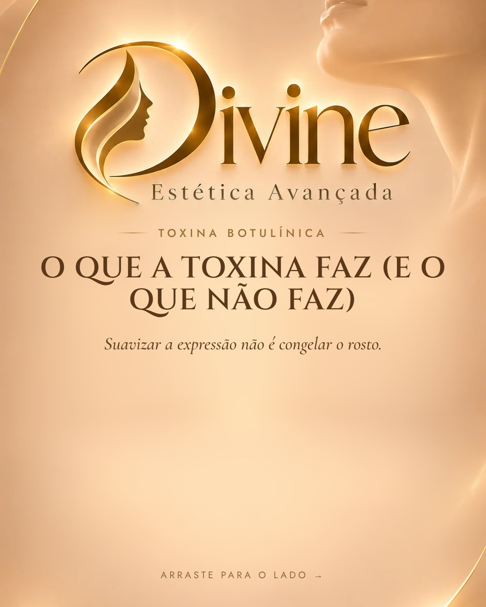
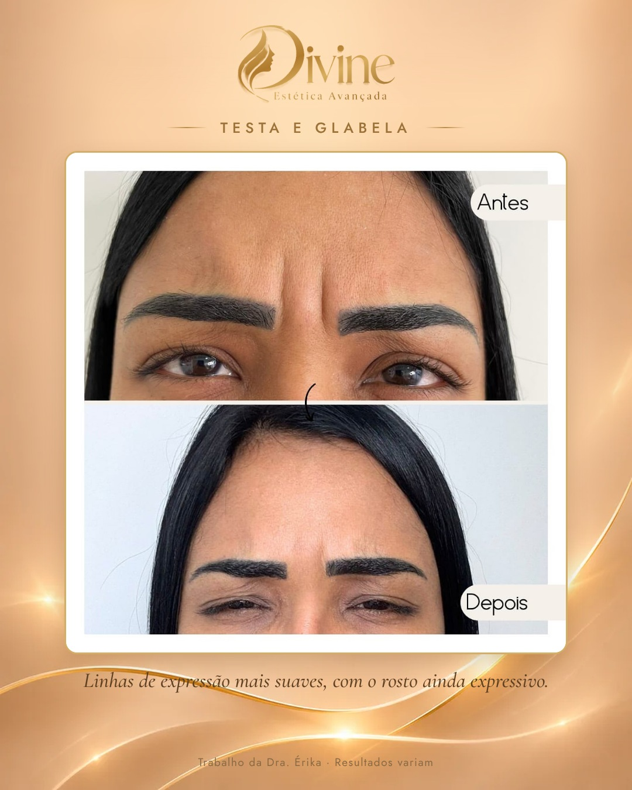

# 18/11 (qua)

[← Voltar ao cronograma](../README.md)

## Feed (carrossel 4) · 19h · P2 · O que a toxina faz

**Como postar:** Não impulsionar. Story do dia: repost deste post com link do grupo.

   

**Legenda (copiar e colar):**

```
Toxina botulínica não é para "congelar" o rosto. ✨

Bem indicada, ela suaviza as linhas de expressão da testa e da região entre as sobrancelhas, e você continua com o rosto expressivo.

O efeito aparece aos poucos nos dias seguintes à aplicação. Na avaliação, a Dra. Érika explica os pontos, o tempo e os cuidados para o seu caso.

Dúvidas? Chama no WhatsApp: link na bio.

#toxinabotulinica #botox #linhasdeexpressao #esteticabrasilia #sudoestebrasilia

Trabalho da Dra. Érika, publicado com autorização da paciente. Resultados variam de pessoa para pessoa.

Dra. Érika Laura Rodrigues · Biomédica esteta · CRBM-3 19227
CLSW 101, Bloco B, Sala 82 · Multiplus Shopping · Sudoeste
```

**Aprovação:** [ ] aprovado  [ ] ajustar
