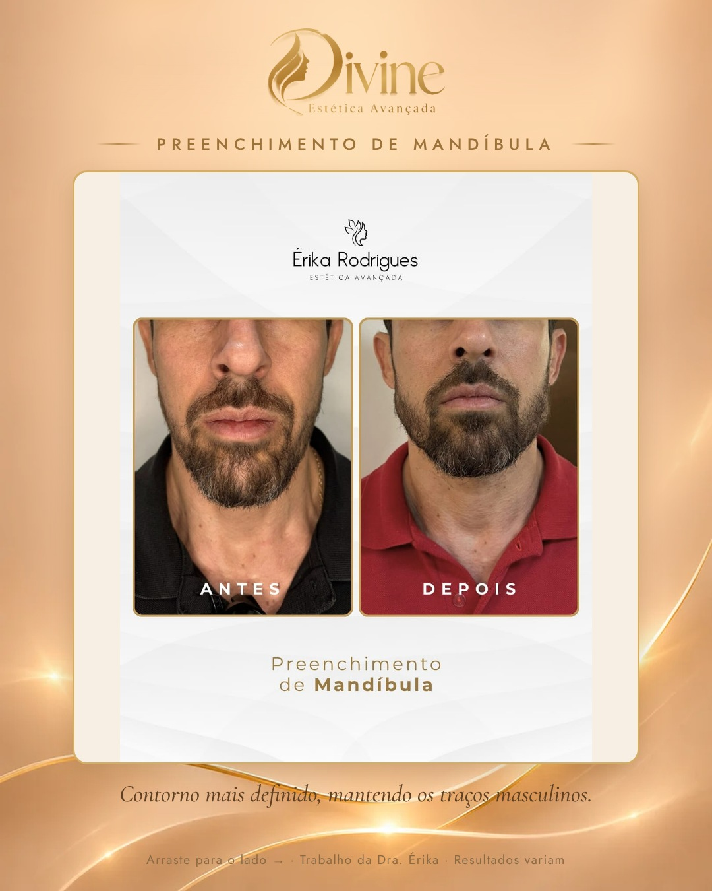

# 25/11 (qua)

[← Voltar ao cronograma](../README.md)

## Feed (carrossel 3) · 19h · P4 · Mandíbula masculina

**Como postar:** Não impulsionar.

  

**Legenda (copiar e colar):**

```
Estética também é para eles. 💈

Nesse caso, o preenchimento de mandíbula deu mais definição ao contorno sem perder os traços masculinos. Nada de rosto "fino" ou artificial.

Mandíbula, mento e toxina estão entre os procedimentos mais procurados por homens. A avaliação define o que faz sentido para cada rosto.

Agende uma conversa pelo WhatsApp: link na bio.

#esteticamasculina #preenchimentodemandibula #harmonizacaomasculina #esteticabrasilia

Trabalho da Dra. Érika, publicado com autorização da paciente. Resultados variam de pessoa para pessoa.

Dra. Érika Laura Rodrigues · Biomédica esteta · CRBM-3 19227
CLSW 101, Bloco B, Sala 82 · Multiplus Shopping · Sudoeste
```

**Aprovação:** [ ] aprovado  [ ] ajustar
