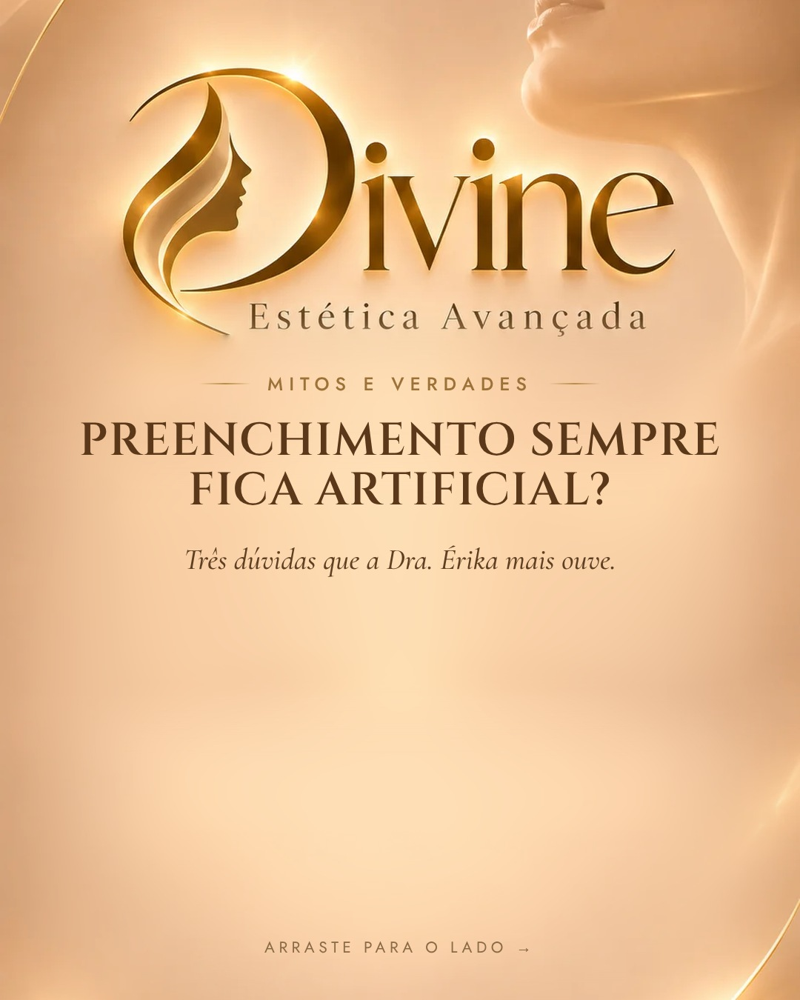
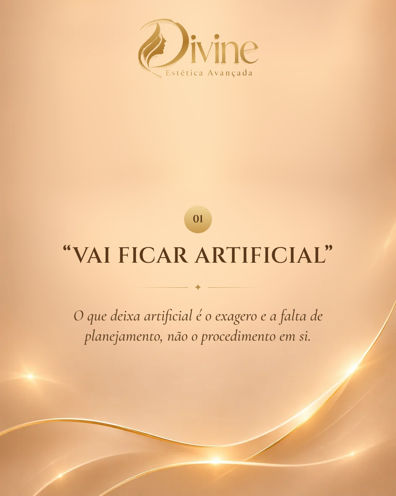
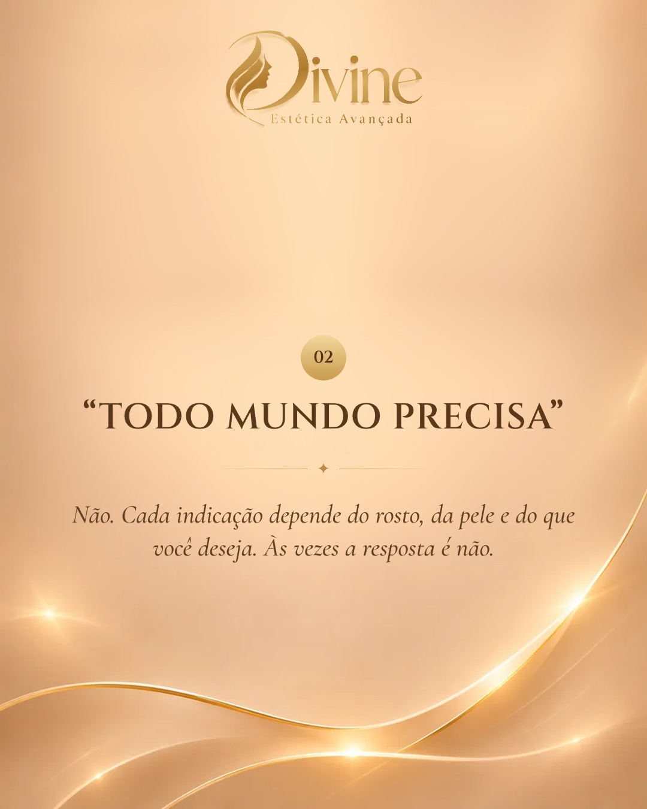
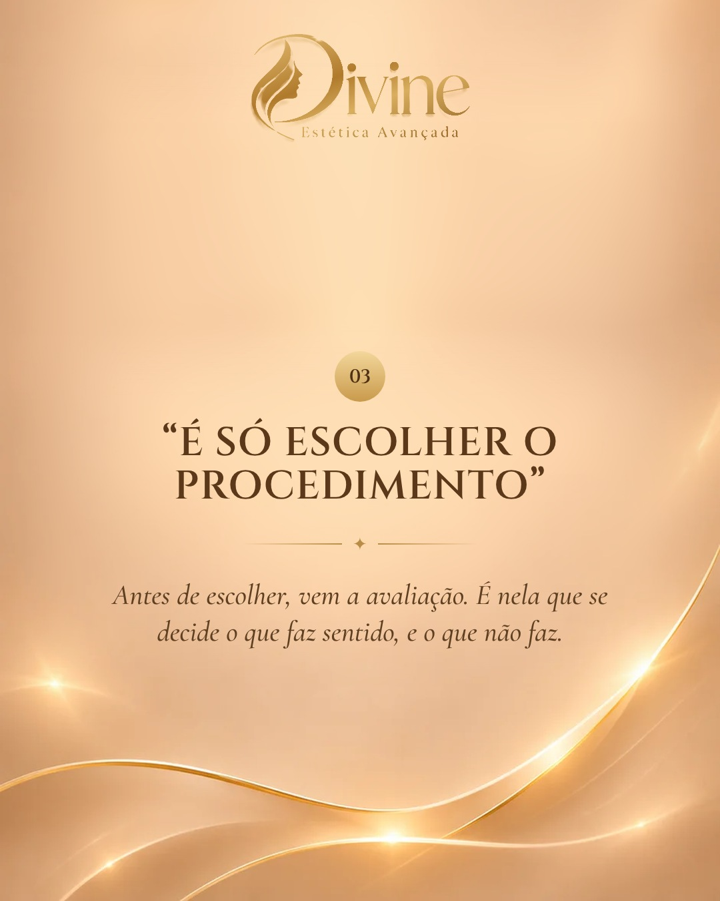

# 27/11 (sex)

[← Voltar ao cronograma](../README.md)

## Feed (carrossel 5) · 19h · P5 · Mitos e verdades

**Como postar:** Repost no story às 20h30.

    

**Legenda (copiar e colar):**

```
"Preenchimento sempre fica artificial?" 🤔

Essa é uma das perguntas que a Dra. Érika mais ouve. Arraste para ver três mitos sobre estética facial.

Spoiler: o que deixa artificial é o exagero e a falta de planejamento, não o procedimento em si.

Ficou alguma dúvida? Manda pra gente nos comentários. 👇

#mitoseverdades #harmonizacaonatural #esteticabrasilia #biomedicinaestetica

Dra. Érika Laura Rodrigues · Biomédica esteta · CRBM-3 19227
CLSW 101, Bloco B, Sala 82 · Multiplus Shopping · Sudoeste
```

**Aprovação:** [ ] aprovado  [ ] ajustar
