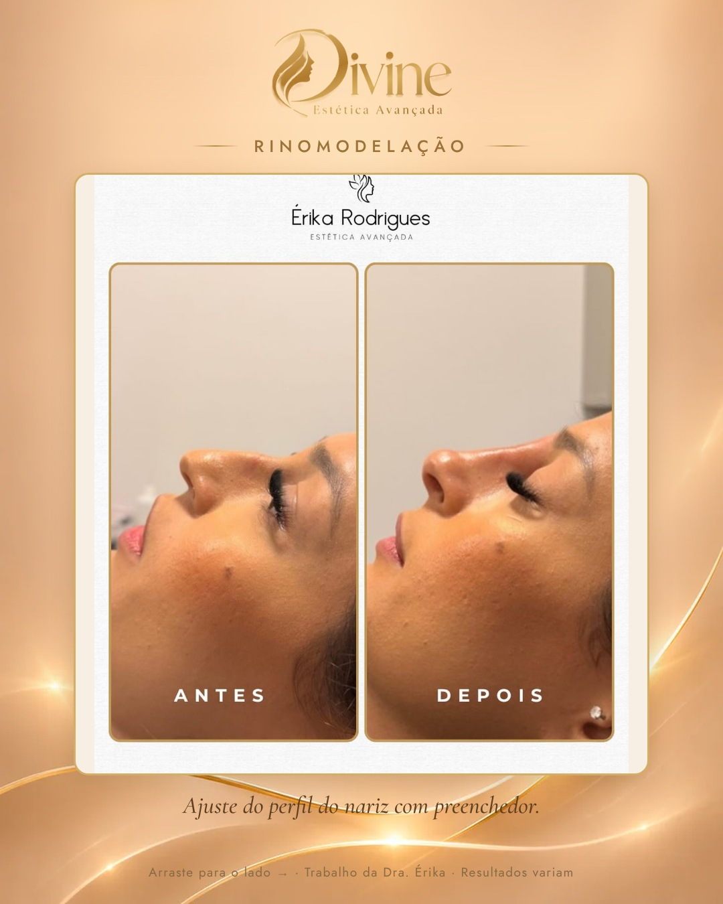

# 30/11 (seg)

[← Voltar ao cronograma](../README.md)

## Feed (carrossel 3) · 19h · P6 · Rinomodelação

**Como postar:** Não impulsionar.

  

**Legenda (copiar e colar):**

```
Rinomodelação: ajustes finos no perfil do nariz, feitos com preenchedor.

Importante: ela serve para pequenas correções de contorno. Não substitui a cirurgia e não é indicada para todo nariz. Quem define é a avaliação, feita com calma e com honestidade sobre o que dá e o que não dá para fazer.

Quer saber se é para você? WhatsApp no link da bio.

#rinomodelacao #harmonizacaofacial #esteticabrasilia #sudoestebrasilia

Trabalho da Dra. Érika, publicado com autorização da paciente. Resultados variam de pessoa para pessoa.

Dra. Érika Laura Rodrigues · Biomédica esteta · CRBM-3 19227
CLSW 101, Bloco B, Sala 82 · Multiplus Shopping · Sudoeste
```

**Aprovação:** [ ] aprovado  [ ] ajustar
