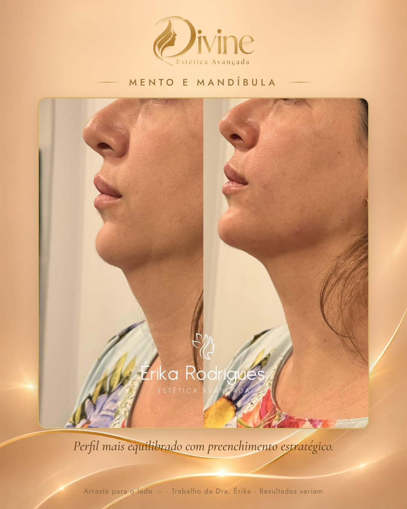

# 02/12 (qua)

[← Voltar ao cronograma](../README.md)

## Feed (carrossel 3) · 19h · P7 · Mento e mandíbula

**Como postar:** Não impulsionar.

  

**Legenda (copiar e colar):**

```
O perfil conta muito sobre a harmonia do rosto.

Queixo e mandíbula ajudam a equilibrar nariz e lábios. Nesse caso, o preenchimento estratégico deixou o perfil mais equilibrado e o contorno mais definido.

Às vezes, o ajuste que harmoniza o rosto não está onde você imagina. É para isso que existe a avaliação.

#preenchimentodemento #mandibula #harmonizacaofacial #esteticabrasilia

Trabalho da Dra. Érika, publicado com autorização da paciente. Resultados variam de pessoa para pessoa.

Dra. Érika Laura Rodrigues · Biomédica esteta · CRBM-3 19227
CLSW 101, Bloco B, Sala 82 · Multiplus Shopping · Sudoeste
```

**Aprovação:** [ ] aprovado  [ ] ajustar
